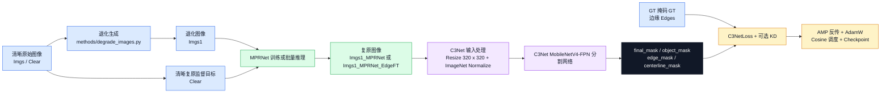

# 当前主流程框架：退化生成、MPRNet 复原与 C3Net 检测

本文档对应当前代码和默认配置 `configs/default.yaml`。AIO 网络已不在主链路中；保留的退化生成脚本用于构造 MPRNet 训练/验证数据，MPRNet 将退化图像复原后，C3Net 在复原图像上完成伪装目标分割。

## 1. 系统总览



关键边界：MPRNet 和 C3Net 目前是**文件级串联**，不是同一个计算图中的端到端联合优化。`Deblurring/batch_restore.py` 将 `Imgs1` 写入 `Imgs1_MPRNet`；C3Net 的 `image_processing.image_subdir` 决定它实际读取哪个复原目录，默认是 `Imgs1_MPRNet_EdgeFT`。

## 2. 数据构造与 MPRNet 复原

### 2.1 退化数据生成

`methods/degrade_images.py` 以清晰图像为源，输出配对数据：

```text
原始数据集
  train/Imgs  ──> train/Imgs1   (退化图像)
  train/Imgs  ──> train/Clear   (清晰参考图)
  train/GT    ──> train/GT      (复制)
  train/Edges ──> train/Edges   (复制)
```

单张图像的退化链由高斯模糊、运动模糊、高斯噪声、低照度和 JPEG 压缩组成。其中运动模糊为主退化，低照度作为辅助退化。该脚本只负责数据构造，不包含或依赖 AIO 网络。

### 2.2 MPRNet 三阶段复原

输入张量为 `B x 3 x H x W`。当前 `Deblurring/training.yml` 启用 `TRAJECTORY_LIGHTWEIGHT=True`，因此主路径是 **3 个重叠全宽条带 -> 1 张完整图像 -> 1 张完整图像**。Stage 1 的 `STAGE1_STRIPES=3`、`STAGE1_OVERLAP=0.25`；Stage 2/3 分别使用一次完整图像，并采用 NAF 轻量编码器/解码器和多尺度融合模块。

```mermaid
flowchart TB
    classDef image fill:#dbeafe,stroke:#2563eb,color:#111827
    classDef stage fill:#dcfce7,stroke:#16a34a,color:#111827
    classDef module fill:#ede9fe,stroke:#7c3aed,color:#111827
    classDef fusion fill:#fef3c7,stroke:#d97706,color:#111827
    classDef out fill:#111827,stroke:#111827,color:#ffffff

    X[退化输入 x3<br/>B x 3 x H x W]:::image --> LA{Light Adaptive<br/>可选}:::module
    LA --> S1

    subgraph S1[Stage 1：3 块局部条带复原]
      direction LR
      P1[3 个重叠全宽横向条带<br/>B x 3 x Hstripe x W]:::image --> SF1[Shallow Feature 1<br/>Conv + CAB]:::module
      SF1 --> E1[Stage-1 Encoder]:::module --> D1[Stage-1 Decoder]:::module --> SAM12[SAM12]:::fusion
      SAM12 --> BLEND[重叠区域加权融合]:::fusion --> R1[整图 Stage-1 图像 + 特征]:::stage
    end

    R1 --> S2
    X --> S2
    subgraph S2[Stage 2：1 张整图上下文复原]
      direction LR
      I2[完整输入图像<br/>B x 3 x H x W]:::image --> SF2[Shallow Feature 2]:::module
      R1 --> C12[Concat + concat12]:::fusion
      SF2 --> C12 --> E2[NAFEncoder + CSFF<br/>方向条带上下文]:::module --> D2[NAFDecoder]:::module --> SAM23[SAM23]:::fusion
      SAM23 --> R2[Stage-2 图像 + 特征]:::stage
    end

    R2 --> S3
    X --> S3
    subgraph S3[Stage 3：全图精修]
      direction LR
      SF3[Shallow Feature 3]:::module --> C23[Concat + concat23]:::fusion
      R2 --> C23 --> O[MultiScaleFusionNAF]:::module
      O --> ER{Stitch Edge Refine<br/>可选}:::module --> T[3 x 3 Tail Conv]:::module
    end
    T --> ADD[残差相加：Tail(x) + x3]:::fusion --> Y[复原图像]:::out
```

阶段职责与共享关系：

- Stage 1 将图像沿高度划分为 3 个有重叠的全宽条带。三个条带复用同一套 `shallow_feat1`、`stage1_encoder`、`stage1_decoder` 和 `sam12`；各尺度特征、解码特征和复原图都用渐变权重融合回整图，避免拼接接缝。
- Stage 2 不再切块，直接以整图 `x3_img` 为输入。`shallow_feat2(x3_img)` 与已融合的 Stage 1 SAM 特征拼接后，经 `concat12 -> NAFEncoder + CSFF -> NAFDecoder -> SAM23` 完成一次全局上下文复原。`CSFF` 将 Stage 1 的编码器/解码器特征跨阶段注入，避免局部复原丢失上下文。
- Stage 3 在全图尺度结合 Stage 2 特征完成全局一致性重建。启用 `edge_refine` 时额外输出边缘预测，可用于缝线边界修正。
- 代码仍保留旧的“四块 -> 两半图 -> 整图”兼容实现，但它仅在 `TRAJECTORY_LIGHTWEIGHT=False` 时被调用，不是当前训练配置使用的流程。
- `batch_restore.py` 会先按 8 的倍数 padding，推理后再去 padding，保证 MPRNet 的下采样/上采样尺寸对齐。

## 3. C3Net 主网络（默认 MobileNetV4-FPN 路径）

默认输入为 `B x 3 x 320 x 320`。MobileNetV4-Hybrid-Medium 产生四层特征，默认尺寸为：`C2=80 x 80`、`C3=40 x 40`、`C4=20 x 20`、`C5=10 x 10`。每层先经 1 x 1 lateral projection 统一到 192 通道，再通过自顶向下 FPN 融合为 `P2...P5`。

```mermaid
flowchart TB
    classDef input fill:#dbeafe,stroke:#2563eb,color:#111827
    classDef backbone fill:#ddd6fe,stroke:#7c3aed,color:#111827
    classDef edge fill:#dcfce7,stroke:#16a34a,color:#111827
    classDef loc fill:#ffe4e6,stroke:#e11d48,color:#111827
    classDef fuse fill:#fef3c7,stroke:#d97706,color:#111827
    classDef out fill:#111827,stroke:#111827,color:#ffffff

    X[复原 RGB 图像<br/>B x 3 x 320 x 320]:::input --> BB[MobileNetV4-Hybrid-Medium<br/>features_only: C2, C3, C4, C5]:::backbone
    BB --> C2[C2: 80 x 80]:::backbone
    BB --> C3[C3: 40 x 40]:::backbone
    BB --> C4[C4: 20 x 20]:::backbone
    BB --> C5[C5: 10 x 10]:::backbone
    C5 --> P5[P5: 192 ch]:::backbone
    C4 --> P4[P4 = L4 + Up P5<br/>DW-separable refine]:::backbone
    P5 --> P4
    C3 --> P3[P3 = L3 + Up P4<br/>CoordAtt]:::backbone
    P4 --> P3
    C2 --> P2[P2 = L2 + Up P3]:::backbone
    P3 --> P2

    P2 --> EI[Concat(P2, Up(P3))<br/>384 ch at 80 x 80]:::edge
    EI --> MRFA[MRFA-DTE<br/>多感受野 + 方向条带卷积 + 门控]:::edge
    MRFA --> EEM[EdgeEnhanceBlock<br/>Sobel/Laplacian 边缘先验]:::edge
    EEM --> EF[边缘特征<br/>128 ch at 80 x 80]:::edge
    EF --> EP[1 x 1]:::edge --> EDGE[edge_mask]:::out
    EF --> CP[1 x 1]:::edge --> CENTER[centerline_mask]:::out

    P4 --> DCG[DeepContextGate(P4, P5)]:::loc
    P5 --> DCG
    DCG --> SEM[SemanticEnhanceBlock]:::loc
    X --> ICGI[下采样到 20 x 20]:::loc
    SEM --> ICG[ICG: Image-based Context Guidance]:::loc
    ICGI --> ICG
    ICG --> LU[Up 到 P2 + P2 残差融合]:::loc
    LU --> LF[Loc refine<br/>128 ch at 80 x 80]:::loc
    LF --> LP[1 x 1]:::loc --> OBJ[object_mask]:::out

    EF --> AFM[AFM / FinalFusionHead]:::fuse
    LF --> AFM
    AFM --> HR[HighResStitchRefineHead<br/>edge + loc + RGB]:::fuse
    X --> HR
    HR --> FINAL[final_mask<br/>B x 1 x 320 x 320]:::out
```

### 3.1 两条分支

- 边缘分支：使用高分辨率的 `P2 + Up(P3)`，默认启用 `MRFA-DTE` 以捕获多尺度、横纵向的缝线轨迹，再经带 Sobel/Laplacian 可学习先验的 `EdgeEnhanceBlock`。它输出 `edge_mask` 和 `centerline_mask`，同时提供融合所需的细粒度边界特征。
- 定位分支：以 `P4/P5` 语义特征为主。`DeepContextGate` 用更深的 P5 调制 P4，`ICG` 将原图的外观和局部对比度引入语义特征，再上采样回 P2 尺度并与 P2 相加，输出 `object_mask` 和定位特征。

### 3.2 AFM 融合与高分辨率细化

`FinalFusionHead` 先把两路 128 通道特征投影到 128 通道。定位特征生成单通道空间注意力图 `A`，仅保留物体区域内有意义的边缘：

```text
E' = AdaptEdge(E) * sigmoid(Conv(AdaptLoc(L)))
F  = Refine(concat(E', AdaptLoc(L)))
M  = Conv1x1(F)
```

默认启用的 `HighResStitchRefineHead` 再融合边缘特征、定位特征和 RGB 图像特征，将最终预测与边缘/中心线预测提升到 `320 x 320`。因此，默认训练配置中的主要输出不再只停留在 P2 的 `80 x 80` 分辨率。

## 4. C3Net 训练和推理

```mermaid
flowchart LR
    classDef data fill:#dbeafe,stroke:#2563eb,color:#111827
    classDef net fill:#ede9fe,stroke:#7c3aed,color:#111827
    classDef loss fill:#fef3c7,stroke:#d97706,color:#111827
    classDef opt fill:#dcfce7,stroke:#16a34a,color:#111827

    A[Imgs1_MPRNet_EdgeFT<br/>GT / Edges]:::data --> B[DataLoader + Resize/Normalize]:::data
    B --> C[Student C3Net]:::net
    B --> T{蒸馏已启用?}:::net
    T -->|是| D[冻结的 DINOv2 Teacher]:::net
    C --> E[四头 logits]:::net
    D --> KD[多头 KL Distillation Loss]:::loss
    E --> KD
    E --> L[C3NetLoss]:::loss
    A --> L
    L --> S[GT 损失<br/>Final + Loc + Edge + Centerline<br/>Topology + Boundary]:::loss
    S --> W[总损失：<br/>(1-kd_weight)*GT + kd_weight*KD]:::loss
    KD --> W
    W --> O[AMP 梯度缩放<br/>Gradient Clip + AdamW]:::opt
    O --> C
```

默认损失权重来自 `configs/default.yaml`：`w_final=1.2`、`w_loc=1.15`、`w_edge=1.0`、`centerline_weight=0.35`、`topology_weight=0.15`、`boundary_weight=0.10`。最终输出使用 logits；仅在损失计算、评估或保存预测时施加 Sigmoid 和尺寸插值。

训练模式默认启用 DINOv2 teacher 蒸馏，student 为 MobileNetV4-FPN C3Net。推理时只加载 C3Net checkpoint，不执行 teacher 分支；评估则在最终掩码上计算 `S_alpha`、加权 F、MAE、E-measure 等指标。

## 5. 运行入口与目录契约

```text
1. 合成退化：  python methods/degrade_images.py --input <dataset> --output <dataset>
2. 训练/推理 MPRNet：Deblurring/train.py、Deblurring/test.py 或 Deblurring/batch_restore.py
3. 训练 C3Net：python main.py train --config configs/default.yaml
4. 评估 C3Net：python main.py evaluate --model <checkpoint>
5. 预测 C3Net：python main.py predict --model <checkpoint> --input <image-or-dir>
```

训练前最重要的目录一致性检查是：MPRNet 实际写入的 `output_subdir` 必须与 C3Net 配置 `model.image_processing.image_subdir` 相同。当前默认 C3Net 读取 `Imgs1_MPRNet_EdgeFT`，而 `batch_restore.py` 的默认写入目录是 `Imgs1_MPRNet`；两者不一致时需要通过配置或命令行参数显式对齐。
