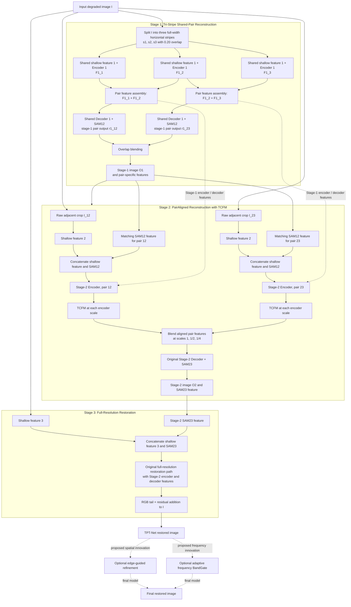

# TPT-Net Architecture

## Canonical names

- **TPT-Net**: **Tri-Pair Trajectory Network**. This is the structural baseline used for all subsequent ablations.
- **TCFM**: **Trajectory-Calibrated Feature Modulation**. This is the Stage-2 cross-stage feature-modulation module.

The current baseline contains a three-stripe front end, adjacent-pair Stage-2 reconstruction, TCFM, and the unchanged full-resolution Stage-3 restoration path. It has no edge refinement or frequency refinement.

## Detailed data flow



## TCFM operation

At every Stage-2 encoder scale, TCFM replaces unconditional cross-stage additive injection. Let `c` be the current Stage-2 feature and `e` / `d` be the aligned Stage-1 encoder / decoder features after their 1x1 projections.

```text
u = concat(c, e, d, abs(e - d))
g = 2 * sigmoid(phi_1x1 -> PReLU -> DWConv(1x7) -> PReLU -> phi_1x1(u))
fused = c + g * (e + d)
```

The final TCFM convolution is zero initialized. Therefore `g = 1` at initialization and the first forward pass is equivalent to unmodulated additive feature injection. Training learns where horizontal trajectory context should attenuate or strengthen the cross-stage contribution.

## Ablation protocol

Use TPT-Net as the fixed baseline. Do not include edge refinement or frequency refinement in its checkpoint.

| ID | Model | Purpose |
|---|---|---|
| B | TPT-Net | Structural baseline |
| E | B + edge-guided refinement | Spatial-boundary innovation |
| F | B + adaptive frequency BandGate | Frequency-detail innovation |
| EF | B + edge-guided refinement + BandGate | Final model |

The existing implementation class and checkpoint paths retain their historical names for compatibility. Use **TPT-Net** and **TCFM** in figures, tables, and writing.

## Innovation A: STAM

**STAM** (Stitch-Trajectory Alignment Module) replaces direct Stage-1 to Stage-2 pair injection with explicit, multi-scale feature alignment.

```text
Stage-2 pair feature + matching Stage-1 encoder feature
    -> horizontal correlation volume over offsets [-6, +6]
    -> learned 2-D trajectory field (horizontal radius 6, vertical radius 1)
    -> differentiable feature resampling
    -> aligned Stage-1 encoder and decoder features
    -> TCFM and Stage-2 encoder
```

STAM is initialized with an identity trajectory field, allowing it to inherit a checkpoint safely. The corresponding experiment uses `training_tpt_net_stam_fast100.yml` and inherits the validated AF-BandGate checkpoint, so its reported gain measures the final-path contribution of trajectory alignment.
